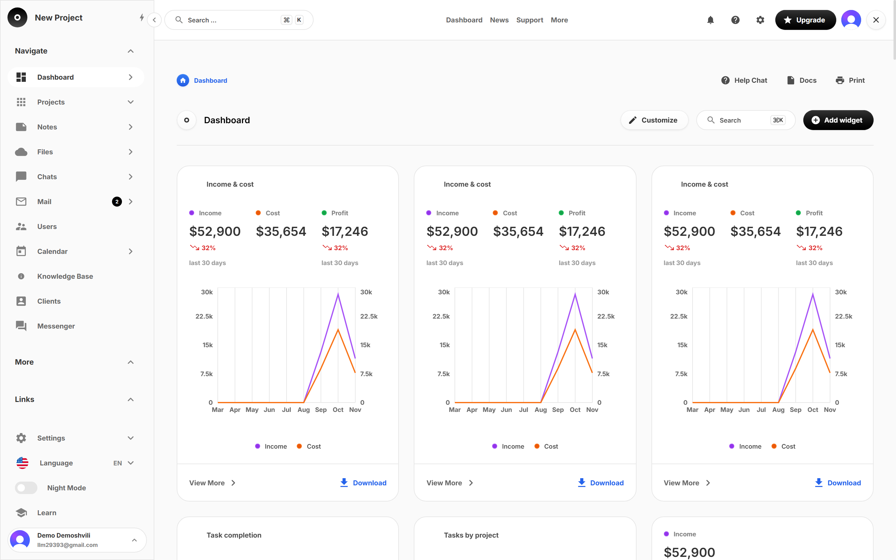
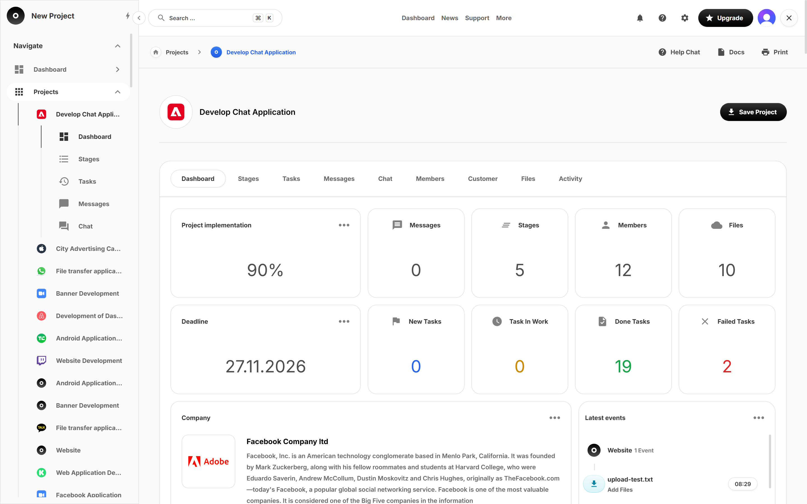

# Dashboard Constructor — demo

[](https://github.com/davita101/ecormce_webstie/actions/workflows/ci.yml)

> **This is a demo.** It shows a dashboard built from the Commerce Constructor 7.7 Figma design system, with a real
> backend behind it. The data you see first is **sample data** copied from the Figma file and loaded into the
> database by a seed script. Projects, tasks, files and messages you create are saved for real, but the app is
> not meant for production use yet (see [Not done / limits](#not-done--limits)).

Live: https://dashboard-constructor.vercel.app

Try it: sign in with Google, or use the demo account `DEMO_EMAIL` / `DEMO_PASSWORD`.

## Screenshots






## Stack

- Next.js 16 (App Router, React 19, TypeScript)
- Tailwind CSS v4 with design tokens generated from the Figma variables (`pnpm tokens` → `src/styles/`)
- shadcn/ui (`base-nova` style on Base UI) for every component
- Clerk for sign-in, Supabase (Postgres + Storage + Realtime) for data, Drizzle ORM for queries
- next-intl for translations, deployed on Vercel

## What is done

### Design system
- Figma variables → CSS tokens: colors (Light/Dark), primary and gray themes, radius, fonts, spacing, line height
- UI components built on shadcn/ui and matched to the Figma file, with previews at `/design-system/<component>`
- Light/Dark mode, theme switching through `data-*` attributes, mobile and desktop layouts from the Figma frames

### Pages
- Auth: sign in, sign up, check email, forgot password, password reset, set new password (Clerk)
- Dashboard (`/dashboard`): customizable widget board (add, remove, reorder widgets; layout saved per user)
- Projects: list with KPIs, finance cards and activity feed; project detail; create / edit / delete project

### Backend
- Database schema: users, clients, projects, members, stages, tasks (with assignees and labels), activity events,
  files, conversations and messages, user settings; row-level security on every table
- Clerk → Supabase user sync through a webhook
- All reads scoped to the signed-in user and cached per user
- Mutations: projects, members (add by email, change role, remove), stages (add, edit, delete, reorder), tasks
  (create, edit, delete, drag between statuses)
- Files: upload to Supabase Storage, signed download links, project and client logos
- Chat: project and direct messages with live updates (Supabase Realtime); Quick Add "Message" dialog
- User settings: theme, language and widget layout saved to the account and restored on any device
- Dashboard widgets show the user's real project numbers (charts, metric tiles, KPI strip, projects table)

## Not done / limits

- **Sample data:** the starting projects, team and events come from the Figma mock-up (`src/db/mock-data.ts`,
  loaded by `pnpm db:seed`, dates moved to recent ones). They are not real customers or money.
- **Demo-only widgets:** the candle chart and the map widget have no data source; they are hidden from the widget picker.
- **No permission model:** every project member can edit everything. Owner/admin rules are needed before real teams use it.
- **Finance trends** compare the last 30 days with the 30 before; there is no real ledger or history.
- **Not built yet** (no Figma pages): Notes, Files, Chats, Mail, Users, Calendar, Knowledge Base, Clients, Messenger,
  and the project tabs (stages, tasks board, messages, members, files, activity). Those sidebar links and tabs show a
  "Coming soon" message.
- Clerk runs on a development instance.

Full task list: [`design/backend/TODO.md`](design/backend/TODO.md). Known design gaps: [`design/known-gaps.md`](design/known-gaps.md).

## My role

<!-- TODO: Davit review: draft written from the git history and code. Rewrite it in your own words. -->

I designed the architecture and directed the build; Claude Code wrote much of the code under my review.

**Architecture decisions**
- **Database schema**: users (Clerk id as primary key), clients, projects, members, stages, tasks with assignees and
  per-project labels, activity events, files, conversations/messages and user settings. Counts (stages, members,
  files, tasks by status, progress) are SQL views (`project_stats`, `stage_stats`), not stored columns, so they can't drift.
- **Drizzle on the server, Supabase client in the browser**: every server read and write goes through Drizzle over the
  Supabase transaction pooler (`prepare: false`). The Supabase JS client is only used in the browser for Storage
  uploads and Realtime, authenticated with the Clerk session token.
- **Row-level security** on every table and on the storage buckets, through `SECURITY DEFINER` helpers
  (`viewer_project_ids()`, `viewer_conversation_ids()`), so the browser client can only reach the viewer's own projects.
- **User scoping**: the Drizzle connection bypasses RLS, so every query takes the Clerk user id and filters by
  membership; cached reads are tagged per user (`user-projects:<id>`) and per project, and writes revalidate those tags.
- **Widget layout persistence**: the dashboard board, theme and language are saved to `user_settings` (`widget_layout`
  jsonb) with an 800 ms debounce and restored on any device.
- **Server Actions + Zod**: every mutation is a Server Action that validates `FormData` with a Zod schema
  (`src/lib/projects/schemas.ts`), checks membership, writes, and returns field errors in friendly words.

**Notable bugs fixed**
- `/dashboard/projects/new` failed to prerender with Cache Components (`new Date()` outside a cache): replaced with an
  hour-cached `cachedNow()` and wrapped the page in Suspense.
- Empty chat/message forms showed raw Zod errors ("Invalid input: expected string, received undefined"): added shared
  friendly field messages for project and chat actions.
- Dashboard chart fixes: tasks-by-project bar axes (one truncated left axis, tooltips) and the mobile chart gap in the
  widget board.
- Sidebar links to unbuilt sections led to 404 pages; they now show a "Coming soon" message.

## Built with Claude Code ❤️

I built this project with [Claude Code](https://claude.com/claude-code), Anthropic's coding agent, using its skills,
MCP servers and custom subagents:

- **MCP servers**
  - **TalkToFigma**: reads the Figma file (components, variants, layers, tokens, PNG exports) straight from the Figma plugin
  - **shadcn MCP**: searches the shadcn/ui registry and adds components
  - **Claude in Chrome**: checks every component and page in a real browser (variants, interactions, console errors)
- **Skills**
  - `shadcn`: shadcn/ui rules for every component
  - `frontend-ui-engineering`, `ui-styling`, `vercel:react-best-practices`: UI code quality
  - `vercel:deploy`: deploys
  - `graphify`: knowledge graph of the codebase
  - `caveman`: shorter replies to save tokens
- **Custom agents and loops** (`.claude/agents/`, `scripts/`)
  - `component-builder` + `director`: build one Figma component, then review it against the Figma data
  - `page-builder`: builds one page from its desktop and mobile frames
  - `todo-director` + `todo-builder`: work through `design/backend/TODO.md` one item at a time (plan → build → review → commit)

## Run locally

```bash
pnpm install
cp .env.example .env.local   # fill in Supabase + Clerk keys
pnpm db:migrate              # apply the schema
pnpm db:seed                 # load the demo data
pnpm dev                     # http://localhost:3000
```

Other commands: `pnpm build`, `pnpm lint`, `pnpm typecheck`, `pnpm tokens` (rebuild tokens after a Figma export),
`pnpm db:studio`.

## Tests

```bash
pnpm test                       # Vitest unit tests (Zod schemas, project and file helpers, finance trend)
pnpm build && pnpm test:e2e     # Playwright smoke test: /sign-in renders with no console errors
```

The e2e test needs a real Clerk publishable key in `.env.local`, or run it against a deployment with
`PLAYWRIGHT_BASE_URL=https://dashboard-constructor.vercel.app pnpm test:e2e`. CI (`.github/workflows/ci.yml`) runs lint,
typecheck, unit tests and build on every push and pull request, with dummy env vars only.
